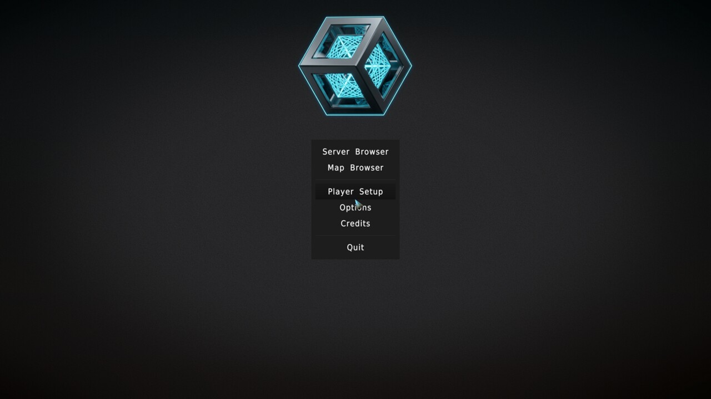
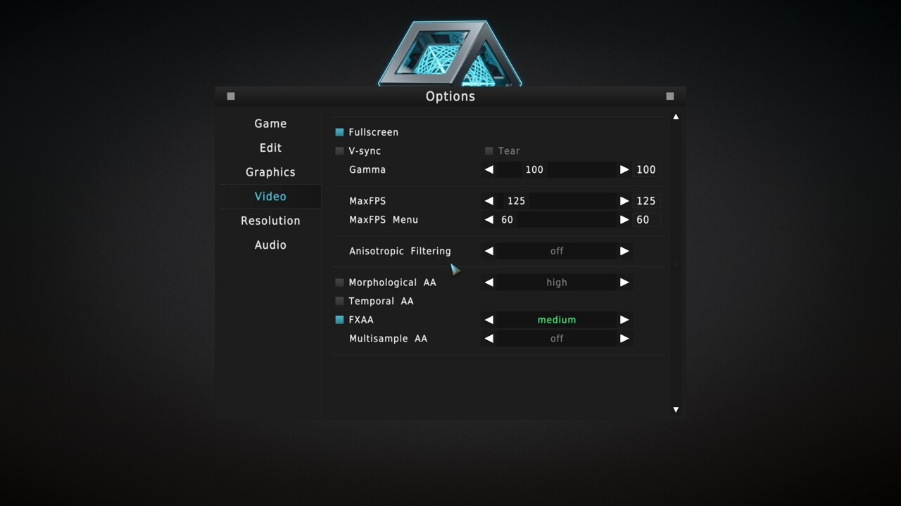
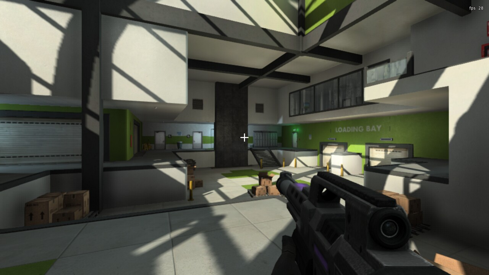
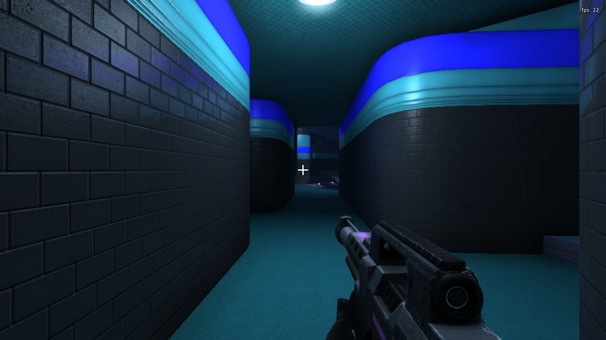
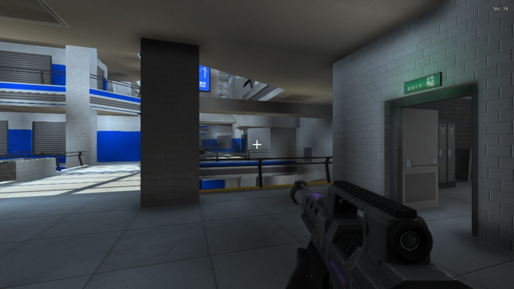

# Tesseract for LG webOS

[Tesseract](https://tesseract.gg), the first-person shooter and map editor with real-time global illumination (the successor of Cube 2: Sauerbraten's engine), built as a native webOS app (`com.pulp.tesseract`). The port is made from Tesseract at commit `db03fcb` of [its GitHub mirror](https://github.com/redeclipse/tesseract), and its renderer runs on OpenGL ES 3.2 instead of desktop OpenGL. It was developed and tested on an LG C1 running webOS 6.5.3 (Mali-G51 GPU).

This is a modified version of Tesseract, not the original: see [How it works](#how-it-works).

## Screenshots

Taken on the LG C1.

| | |
|---|---|
|  |  |
| The main menu | The Options, chosen with the remote's arrows |
|  |  |
| complex | waterworks |
|  | |
| reflection | |

## Requirements

- **An ARMv8 CPU**, as in TVs with a 64-bit kernel such as the LG C1. The code is built for the Cortex-A55 in 32-bit mode, so it doesn't run on older ARMv7-only TVs.
- **OpenGL ES 3.2.**
- **About 80 MB** of app storage.
- **Root is not needed.** It installs from the Homebrew Channel or with `ares-install` in Developer Mode.

## Playing

The Map Browser opens any of the included maps, and the Server Browser finds games online.

**Controls.**

- **Magic Remote:**
  - in the menus, point and click, or let the arrows step between the buttons, the tabs and the sliders' arrows, OK pressing the one under the pointer; Back goes back;
  - in a game, Up and Down walk, Left and Right turn, OK shoots and Back opens the menu.
- **Game controller,** with the layout of the Quake III port:
  - the left stick (or the D-pad) walks and the right stick looks around;
  - R2 shoots and L2 zooms;
  - L1 and Cross (A) jump, Circle (B) crouches and Square (X) hits;
  - R1 and Triangle (Y) change to the next and the previous weapon;
  - Share (Back) holds up the scores, and Options (Start) opens the menu;
  - in the menus the D-pad steps between buttons, the sticks move the pointer, Cross clicks and Circle goes back.
- **A USB keyboard and mouse** work as on a PC, with Tesseract's own keys.

When you press Home, the game pauses: it stops drawing, its sound stops, a game on your own stands still, and the settings are saved. The settings are saved on quitting too.

**The picture.** The game draws 75% of the screen's width and height (1440x810 on a 1080p TV) and scales it up, smooths edges with FXAA, and leaves out the volumetric light (sunbeams), which halves the frame rate in sunlit views. Frame rates on the C1 range from about 20 to 60 depending on the map and where you look: the open, simply lit maps such as ot and turbine run fastest, and the big sunlit halls of complex slowest. The frame rate shows in the top right corner. The Options change all of this; SMAA and temporal antialiasing cost 15-20%.

The TV gives apps a 1080p screen, so 4K output isn't possible; drawing at 4K and scaling down ran at about 10 frames a second.

## How it works

- **OpenGL ES 3.2** (`patches/tesseract-webos.patch`):
  - the shaders are compiled as GLSL ES 3.20, with Tesseract's rectangle textures as 2D textures read with normalized coordinates;
  - each texture format becomes the exact internal format, format and type that OpenGL ES requires (`texture.cpp`);
  - the functions OpenGL ES lacks are made from ones it has: `glVertexAttrib4Nubv`, `glMultiDrawArrays`, `glGetQueryObjectiv`, `glFramebufferTexture3D`, `glDrawBuffer`, `glClearDepth` and `glDepthRange`;
  - texture compression and desktop-only extensions are off.
- **The shader cache.** Compiling Tesseract's shaders takes the TV's GPU about 30 seconds. The compiled programs are saved with `glGetProgramBinary` in `home/cache/shaders/`, keyed by their sources and the GPU driver, so later starts load them in a fraction of a second.
- **`src/engine/webos.cpp`** (new):
  - the remote and game controllers: the controllers' buttons, triggers and left stick become keys named `PAD_*` (`config/keymap.cfg`), bound in `config/webos.cfg`, and the right stick and the remote's Left and Right turn the view;
  - the menus with the arrows: `UI::navigate` (`ui.cpp`) moves the pointer to the nearest button, slider or text field in the arrow's direction, as long as no text is being typed;
  - Home pauses the game.
- **`config/webos.cfg`** (new) holds the binds and the settings for the TV. The game runs it on its first start, and again when its version (`webosconfig`) is newer than the one in the saved settings.
- **`main.cpp`:**
  - the game's output goes to `/tmp/tesseract.log`;
  - a crash logs the signal and a backtrace there;
  - the app manager's JSON launch parameters are ignored;
  - SDL is asked for the remote's Back button and for game controllers, and for the DualShock 4's and DualSense's own protocol, which keeps their light bar steady.
- **The media.** Tesseract's media take 270 MB, more than the TV's app storage holds: `tools/slim-media.py` turns the opaque PNG images of the textures, skies and models into JPEG, which brings the package down to 72 MB (78 MB installed). `tools/menu-logo.py` puts the app's logo in the main menu, and `tools/icon.py` makes the icons from it.
- **GCC 16:** `tools.h` includes `<new>` instead of defining placement new itself.

**Settings for testing.** `/tmp/tesseract.env` on the TV, one `NAME=value` a line, sets environment variables for the next launch:

- `WEBOS_DEBUG=1`: logs the frame rate and the shader cache every 5 seconds, and a backtrace on exit;
- `WEBOS_MAP`: the map to load at the start;
- `WEBOS_EXEC`: CubeScript to run at the start (for example `sleep 20000 [gscale 100]`); while it's set, the settings aren't saved;
- `WEBOS_SHADERCACHE=0`: compiles the shaders without the cache.

## Build

On an x86-64 Linux machine with git, curl, make, and Python 3 with Pillow:

```sh
./build-deps.sh  # first run: fetches the openlgtv toolchain (2026.08-webos); webosbrew's SDL 2.30.12, SDL2_image and SDL2_mixer into prefix/
./build.sh       # first run: fetches Tesseract at db03fcb into tesseract-src/ and applies the patch; builds the game
./package.sh     # writes output/com.pulp.tesseract_<version>_all.ipk and the manifest
```

`package.sh` checks that every symbol the game needs is defined by a library on the TV, given a copy of the TV's libraries: run `tools/fetch-tv-libs.sh root@<tv address>` once. Without that copy, the check is skipped.

To install a build by hand as root on the TV:

```sh
luna-send -i -f luna://com.webos.appInstallService/dev/install \
  '{"id":"com.pulp.tesseract","ipkUrl":"/tmp/com.pulp.tesseract_0.1.0_all.ipk","subscribe":true}'
```

## License

The patch and the scripts are under the zlib license, as Tesseract's code is; see `LICENSE`. The app's logo, `app/logo.jpg`, is this port's own; the icons and the menu logo are made from it.

What the app is made from:

- Tesseract's code: zlib license (`src/readme_tesseract.txt`, packaged as `LICENSE`), with ENet under an MIT-style license;
- Tesseract's media: each folder's own license, in the `info.txt` or readme file beside it. Most are CC0 or CC BY-SA 3.0; the Uphys sounds are CC BY-NC 4.0, and the Soundsnap sounds and the 0ptikz skies may not be sold. The package lists its changes to them in `MEDIA-CHANGES.txt`;
- SDL, SDL2_image and SDL2_mixer: zlib license.
